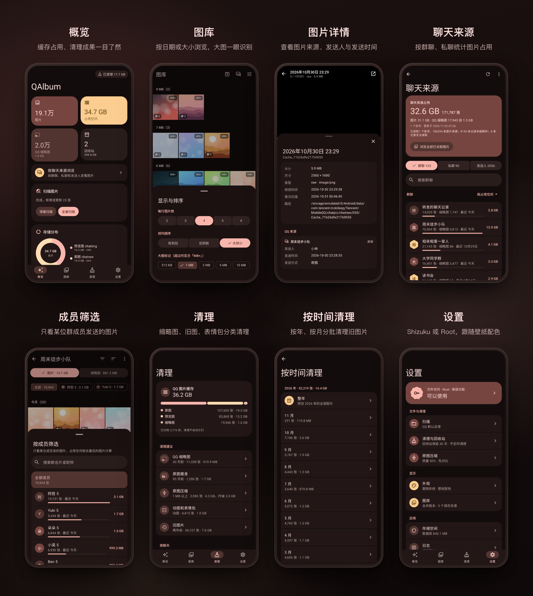

# QAlbum

像系统相册一样查看、管理与清理QQ的缓存图片

QQ 聊天里的图片随着时间越积越多，体积占用越来越大，QQ内置清理又过于宽大，不想全部删除？想看看哪个人发送的图片最多？或是仅仅想看看某些群里的图片？来试试 QAlbum 吧！QAlbum 通过 Shizuku 或 Root 读取这些图片，让你像翻相册一样浏览，并支持按来源、规则与分类清理这些图片

> [!WARNING] 
>
> 删除、压缩等操作会直接改动设备上的文件，部分操作不可撤销。使用前请务必备份重要数据！QQ版本更新可能会对部分逻辑进行修改，建议批量清理前请先少量测试，以免出现问题。

### 如果这个项目对你有帮助，欢迎点个 Star ！你的支持是我最大的动力！

## 截图演示

*截图素材来自0.4.5版本，新版可能有差异

## 功能

- **图库**：按日期或大小排序浏览所有图片，支持合并同一张图的原图、预览图与缩略图
- **清理规则**：支持按缩略图、旧图、表情包等规则批量清理，支持定时清理
- **原图压缩**：压缩体积大的原图，既不丢失，也能节省空间
- **回收站**：删除的图片先进回收站，到期后才会删除，可以随时恢复
- **归档**：将不想删除的图片归档，所有类型清理将会跳过他们
- **聊天来源**（高级功能）：需要 Root，支持按群聊和发送人浏览、清理图片，支持查看每张图片的来源与发送人，支持按更高级的规则整理与合并图片
- **聊天视频**：支持查看和管理聊天视频
- **...还有更多！**

## 使用要求

- QQ 9.x 以上
- Android 8.0 及以上
- [Shizuku](https://shizuku.rikka.app/) 或 Root（高级功能）

## 下载

QAlbum 永久开源免费，只在 [GitHub Releases](https://github.com/xiaojiuwo233/QAlbum/releases) 发布。

任何其他渠道的安装包都未经授权，可能被篡改或含有恶意代码，请注意甄别！

## 反馈

如果你在使用过程中遇到了问题，欢迎在 [issue](https://github.com/xiaojiuwo233/QAlbum/issues/new) 中提出，提出问题时请附上日志与必要的复现步骤。

## 免责声明

本项目仅供学习与研究使用。使用时请遵守《腾讯 QQ 软件许可及服务协议》与《应用用户协议》，因使用本工具造成的任何损失由使用者自行承担。

## 致谢

本项目在开发过程中参考或使用了以下项目，向他们表示感谢！

- [QQDecrypt](https://github.com/QQBackup/QQDecrypt)
- [Immich](https://github.com/immich-app/immich)

## 许可证

本项目采用 [GNU Affero General Public License v3.0（AGPL-3.0）](LICENSE) 许可。